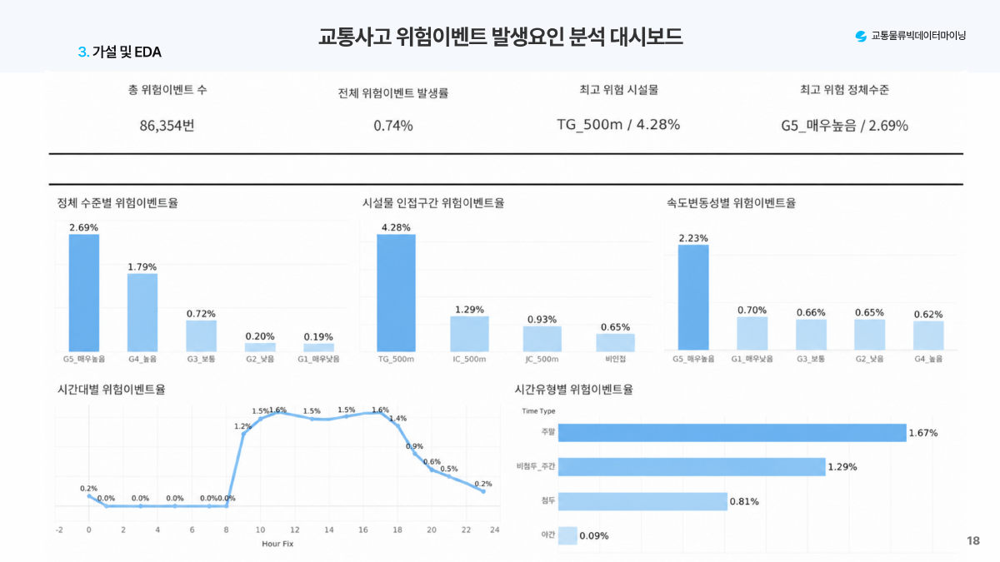

# 고속도로 위험이벤트 분석 및 예측

한국도로공사 연계형 프로젝트 · 엑설런스상(한양대학교 총장상)  
2026학년도 1학기 교통물류빅데이터마이닝

경부고속도로의 교통류·기상·도로구조·시설물 자료를 결합해 위험이벤트 발생 조건을 분석하고, 변수 구성에 따른 분류 성능을 비교했다.

## 분석 결과

2022년 1–4월 구서IC–양재IC 구간의 11,704,666행을 통합했다. 사고 또는 급감속이 기록된 행은 86,354개로 전체의 0.7378%였다.

| 지표 | 교통류 변수 구성 | 통합 변수 구성 |
|---|---:|---:|
| ROC-AUC | 0.9032 | 0.9768 |
| Recall | 81.22% | 91.30% |
| Precision | 55.85% | 78.57% |
| F1 | 0.6619 | 0.8446 |

Recall은 10.09%p, F1은 0.1827 높아졌다. 위험이벤트 전체와 정상 행 3%를 추출한 표본의 무작위 70:30 분할 결과다. 원래 발생률에서의 정밀도나 미래 시점 예측 성능은 추가 검증이 필요하다.

## 분석 과정

자료 통합 → 전처리·파생변수 → EDA·가설검정 → 변수 선택 → 5개 모델 비교·튜닝 → LightGBM·SHAP 해석

교통류 밀도·속도 변동·시간대·도로선형·시설물 인접성을 검토했다. 최종 15개 변수의 LightGBM을 선정하고 SHAP으로 변수별 예측 기여를 확인했다. [워크플로우](docs/workflow.md)

TG·IC 주변과 고밀도·속도 변동이 큰 구간의 우선 모니터링을 제안했다. 집단 간 관측 차이와 모델 중요도를 근거로 한 제안이며 실제 사고 감소 효과는 측정하지 않았다.

## 담당 업무

데이터 통합·전처리, 파생변수, EDA·가설검정, Tableau 대시보드, 변수 선택, 모델링·튜닝과 SHAP 해석까지 분석 전반을 수행했다. 발표자료를 보완하고 주요 질의응답을 담당했다. 도로기하구조 데이터 구축, 발표자료 제작과 발표는 팀원이 맡았다.

## 보고서와 코드

- [기술보고서](reports/technical_report.md) · [최종 발표자료 PDF](reports/final_presentation_public.pdf)
- [R 분석 코드와 실행 순서](analysis/README.md)
- [모델 평가·SHAP 결과](results/model/) · [EDA 집계](results/eda/)
- [Tableau](tableau/) · [데이터 준비](data/README.md)

기술: R · data.table · XGBoost · LightGBM · SHAP · Tableau

## 실행과 한계

프로젝트 파일을 열고 `source("setup.R")`로 패키지를 준비한다. 데이터 위치는 `TRAFFIC_PROJECT_DATA_DIR`로 지정할 수 있다. 원본 자료와 행 단위 가공 데이터는 포함하지 않았다. 스크립트별 입력 조건은 실행 안내에 있다.

타겟은 같은 관측행의 사고 또는 급감속이다. 단일 노선·4개월 자료의 무작위 분할을 사용해 시간·공간 중첩 가능성이 남는다. 통합 구성에는 교통류 기준의 `occ`가 없어 추가 변수만 쌓은 엄밀한 중첩 비교도 아니다. 최종 15개 입력에는 직접 기상변수가 선택되지 않았다.

코드와 저장 결과를 정리했으며 이번 공개 과정에서 재학습하지 않았다. [자료 구성과 변경 내역](docs/source_map.md)
