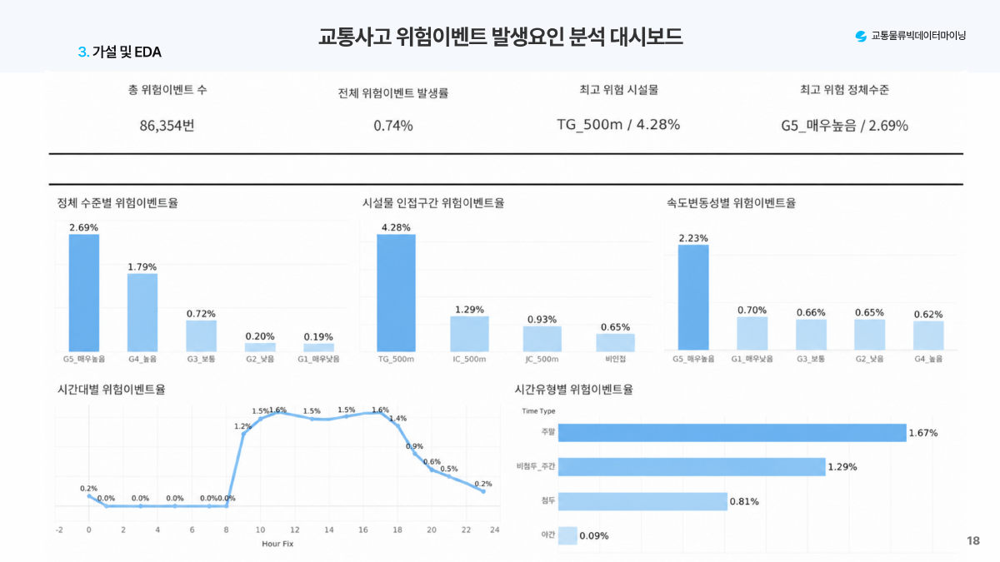
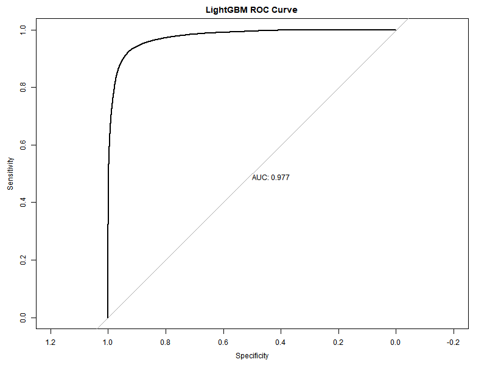
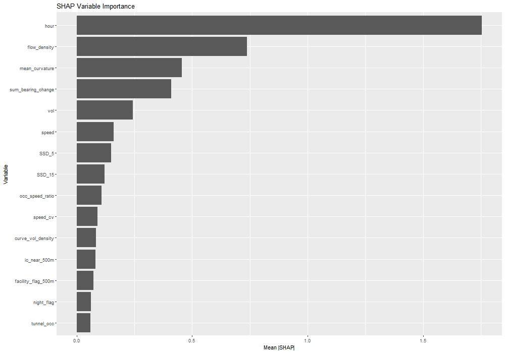

# 고속도로 위험이벤트 예측 기술보고서

## 1. 연구 목적

교통류만으로 설명하기 어려운 위험이벤트의 특성을 기상·도로선형·시설물·시간 정보와 함께 분석했다. 위험이벤트 발생 조건을 비교하고, 통합 변수 구성이 분류 성능을 얼마나 개선하는지 확인했다.

2026학년도 1학기 한국도로공사 연계 교통물류빅데이터마이닝 프로젝트로 수행했으며 엑설런스상(한양대학교 총장상)을 수상했다. 데이터 통합부터 모델링·해석까지 분석 전반과 발표자료 보완·주요 질의응답은 정채환이 수행했다. 도로기하구조 데이터 구축과 발표는 팀원 담당이다.

## 2. 데이터와 타겟

| 구분 | 범위 |
| --- | --- |
| 대상 | 경부고속도로 구서IC–양재IC |
| 분석 기간 | 2022.01.01–2022.04.30 |
| 교통류 | VDS 5분 단위 속도·교통량·점유율 |
| 기상 | ASOS 시간 단위 관측 |
| 도로 정보 | 굴곡도, 교량·터널, IC·JC·TG 위치와 인접성 |
| 최종 데이터마트 | 11,704,666행 |
| 위험이벤트 | 86,354행 · 0.7378% |

타겟 `event_binary`는 같은 관측행에서 `crash_count > 0` 또는 `hardbraking_count > 0`이면 1이다. 이는 사고만을 대상으로 한 모델이 아니며, 예측 시점 이후의 사고를 별도 미래 라벨로 만든 설계도 아니다.

VDS 구간에 대표 ASOS 관측소를 수동 매핑해 시간 단위로 결합했다. 도로선형은 0.5km 단위로 집계하고 실제 이정에 맞춰 매핑했으며, 콘존별 교량·터널과 차로수, 가장 가까운 시설물까지의 거리 등을 결합했다. SHP 원본은 제공 폴더에서 확인되지 않아 해당 단계의 완전한 재현에는 추가 입력이 필요한다.

## 3. 전처리와 피처 엔지니어링

위험 상황 자체가 교통류 이상 패턴일 수 있어 IQR 기준으로 일괄 제거하지 않았다. 음수 속도·교통량·점유율, 속도 150 초과, 점유율 100 초과 등 물리적으로 부적절한 값을 처리했다. 기온은 보간 후 중앙값으로 보완하고, 강수·적설 결측은 0으로 처리했다. 후자의 기준은 기상 결측의 의미에 영향을 받으므로 향후 관측 상태와 함께 재검토할 필요가 있다.

속도 변동계수, 교통류 밀도, 점유율/속도 비율, 시간·공간 속도차, 시설물 500m 인접성, 굴곡도와 교통류의 교호항 등을 생성했다. lag와 rolling 계산으로 생긴 구조적 결측에는 0 대체를 적용했다.

`SSD_5`, `SSD_10`, `SSD_15`는 코드상 같은 시각의 도로 이정 정렬 후 1·2·3번째 앞 관측행과의 속도차이다. 이름이 고정된 물리적 거리 5·10·15km를 보장하지는 않습니다. 시간 lag도 관측 간격과 결측 제거의 영향을 확인해야 한다.

사고 차종은 사고 이후 기록되는 정보이므로 보조 EDA에만 사용했다. 사고 횟수·급감속 횟수·위험점수·누적 이벤트 등 타겟에 직접 연관된 변수는 모델 입력에서 제외했다.

## 4. EDA와 가설검정

| 조건 | 위험이벤트율 |
| --- | ---: |
| 정체 수준 낮은 그룹 | 0.191% |
| 정체 수준 높은 그룹 | 2.685% |
| 속도 변동성 매우 높은 그룹 | 2.228% |
| TG 500m 인접 | 4.278% |
| IC 500m 인접 | 1.295% |
| JC 500m 인접 | 0.931% |
| 시설물 비인접 | 0.645% |

정체 수준과 속도 변동성은 단변량 로지스틱 회귀, 시설물 인접성은 카이제곱 검정으로 확인했다. 자료에는 p < 2e-16 수준의 유의성이 제시되어 있다. 관측행의 시간·공간 의존성과 대규모 표본을 고려하면 p-value만으로 인과관계나 실무 효과의 크기를 판단할 수 없다.

강수·습윤 그룹과 높은 굴곡도 그룹은 당초 가설과 반대 방향을 보였습니다. 예상과 다른 결과도 그대로 보고하고, 노선·시기·구간별 노출 차이를 추가 검토 대상으로 남겼습니다.

## 5. 모델링과 변수 선택

1. 위험이벤트 행은 모두 유지하고 정상 행은 3% 추출했다. 모델링 표본은 434,904행(정상 348,550, 위험이벤트 86,354)이다.
2. 클래스별 무작위 70:30으로 훈련·평가 데이터를 나눴습니다.
3. EDA와 검정으로 후보 변수를 구성하고, XGBoost 중요도를 참고해 최종 15개 변수를 선정했다.
4. Logistic Regression, Decision Tree, Random Forest, XGBoost, LightGBM을 비교했다.
5. Random Forest와 LightGBM은 훈련 분할에서 5-Fold 교차검증과 그리드 탐색을 수행했다. CV에서는 F1을 우선하고 AUC·Recall을 함께 참고했다.
6. 최종 LightGBM의 예측 기여를 평가 표본 중 최대 5,000행의 SHAP 값으로 분석했다.

LightGBM 최적 설정은 num_leaves=63, max_depth=7, learning_rate=0.05, feature_fraction=0.8, bagging_fraction=0.8, bagging_freq=1, nrounds=300이다. 양성 가중치는 훈련 표본의 음성/양성 비율을 사용했다.

## 6. 성능과 개선 폭

[저장된 비교 결과](../results/model/additional_variable_effect.csv) 기준이다.

| 지표 | 교통류 변수 구성 | 통합 변수 구성 | 절대 개선 폭 |
| --- | ---: | ---: | ---: |
| Accuracy | 0.8352 | 0.9333 | +0.0981 |
| Precision | 0.5585 | 0.7857 | +0.2272 |
| Recall | 0.8122 | 0.9130 | +0.1009 |
| F1 | 0.6619 | 0.8446 | +0.1827 |
| ROC-AUC | 0.9032 | 0.9768 | +0.0736 |

재현율은 **10.09%p**, 정밀도는 **22.72%p** 향상됐습니다. 발표자료의 +12.4% 등은 상대 증가율로, %p 차이와 구분한다.

최종 LightGBM 혼동행렬은 TN 98,114, FP 6,452, FN 2,253, TP 23,654이며, 임계값은 0.5이다. [최종 결과표](../results/model/final_model_results.csv)와 일치한다.

교통류 구성은 `speed`, `vol`, `occ`, `flow_density`, `occ_speed_ratio`, `speed_cv`, `SSD_5`, `SSD_15`이다. 통합 구성은 15개 변수로 시간·도로선형·시설물 변수를 포함하지만 `occ`는 제외한다. 따라서 추가 변수의 개별 효과를 고립시킨 중첩 실험은 아니다.

초기 Random Forest 비교 결과는 AUC 0.9754, F1 0.8605였으나, 제한된 maxnodes 그리드로 튜닝한 최종 Random Forest 결과는 AUC 0.8757, F1 0.6597이다. 서로 다른 단계의 결과를 섞어 튜닝으로 모든 모델의 성능이 향상됐다고 해석하지 않았다.

## 7. SHAP 해석과 운영 방향

SHAP 평균 절댓값에서는 hour, flow_density, mean_curvature, sum_bearing_change가 상위였습니다. 고밀도·속도 변동과 시설물 인접 조건을 함께 모니터링하고, TG·IC 주변 및 정체 구간의 안전관리를 우선 검토하는 방향을 제안했다. 변수 중요도나 SHAP은 모델의 예측 기여를 설명하며, 해당 조건을 바꿨을 때 사고가 감소한다는 인과효과를 뜻하지 않습니다.

## 8. 검증 범위와 한계

- **표본 분포:** 음성 3% 추출로 위험이벤트 비율이 원래 0.7378%보다 크게 높아졌습니다. Precision·Accuracy·F1을 실제 교통 데이터의 같은 수치로 해석할 수 없다.
- **시간·공간 검증:** 무작위 분할을 사용해 인접 시각·동일 구간의 유사 관측이 훈련·평가에 함께 들어갈 수 있다. 기간·노선·구간 단위 외부 검증이 필요한다.
- **예측 시점:** 현재 행의 교통 상태로 현재 행의 위험이벤트를 분류한다. 사전 경보 성능을 주장하려면 예측 시점 이후의 타겟과 이용 가능한 입력을 별도로 정의해야 한다.
- **변수 선택:** 초기 중요도 분석의 평가 세트가 early stopping에 사용됐고 이후 표본 재분할·변수 선택 과정이 있어, 훈련 내부에서 변수 선택까지 수행하는 검증이 필요한다.
- **기상 해석:** 최종 15개 입력에는 기상 변수가 직접 포함되지 않습니다. 통합 모델의 성능 향상을 기상 변수의 효과라고 단정할 수 없다.
- **운영 효과:** 실시간 배포와 사고 감소 효과는 검증하지 않았다.
- **재현 환경:** 원본 데이터·SHP와 패키지 버전 기록이 불완전한다. 공개본은 저장된 분석 산출물이며 현재 환경에서 재학습하지 않았다.

## 9. 자료 위치

- [최종 발표 PDF](final_presentation_public.pdf)

- [분석 코드와 실행 조건](../analysis/README.md)
- [집계 결과](../results/eda/)
- [모델 평가·해석 결과](../results/model/)
- [데이터 입력 안내](../data/README.md)
- [원본 파일 대응표](../docs/source_map.md)
