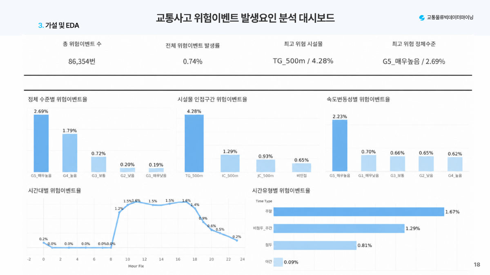

# 위험이벤트 발생 요인 분석 대시보드

정체 수준, 시설물 인접성, 속도 변동성과 시간대에 따른 위험이벤트율을 비교합니다. 원본 TWBX에서 대시보드 정의인 TWB만 추출했으며 내장 Hyper 데이터는 제외했습니다.

`highway_risk_dashboard.twb`를 Tableau Desktop에서 열고 각 CSV 연결을 `results/eda/`의 해당 파일로 지정합니다. 기존 Hyper 추출을 찾을 수 없으면 CSV로 연결을 교체한 뒤 추출을 재생성합니다. 모든 참조 CSV가 포함되어 있는지는 자동 점검했으며, Tableau Desktop에서 재연결 검증은 수행하지 않았습니다.
